# @berry889888 ("Berry"): What Makes It Go Viral

A breakdown of the account's top 8 videos by views, checked frame by frame at 30 fps, plus stats for all 43 videos on the profile. It covers the series, scripts, hooks, edit, lighting, captions and sound, and why people rewatch and share.

> **Scope.** The profile listing (43 videos, 12 Oct – 6 Nov 2026) and view/like/share/save counts were read on **6 Nov 2026, ~15:08 UTC**. The **top 8 by views** were downloaded at 1080×1920 and analysed: **9.2 minutes, 16,568 frames at 30 fps**. Comments could not be retrieved (TikTok's comment API refused plain requests), so audience reactions are inferred from the share/save ratios, not read.
>
> **Note.** These are a different style from the six MP4s you attached. Those come from three other stickman channels and are analysed in [`../viral-stickman-tiktok-analysis.md`](../viral-stickman-tiktok-analysis.md). Section 11 compares the two.

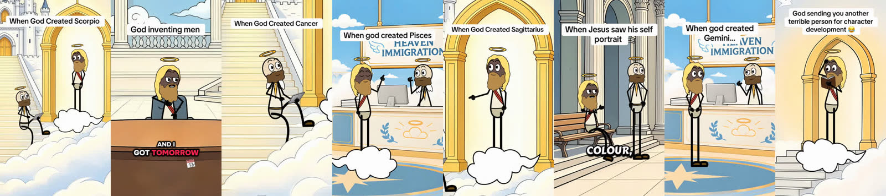

---

## 1. TL;DR: Berry's formula

1. **One evergreen, identity-based series.** "When God Created [Zodiac Sign]" is 14 of 43 videos but **54 % of all views** (1.75 M of 3.24 M), with a **median of 66 k views vs. 12–23 k** for the other series. Every viewer has a sign, so each video has a built-in audience that self-identifies, tags friends and comes back for the next sign.
2. **The creation-factory premise.** God stands on a cloud under a golden arch and dictates personality traits. A note-taking angel on the stairs (holding a tablet) asks **"Okay, how much?"** God answers with a hyperbolic but *accurate* trait.
3. **A joke every ~5 s, no dead air.** Each trait is a mini setup → punch. The angel is the straight man who keeps feeding setups.
4. **Signature ending:** the angel's one-word verdict, then God's stamp: **"That's extreme." / "That's Scorpio."** It closes on the sign's name and loops straight back to **"Alright, next is…"**.
5. **Frame 0 = title + motion + voice.** A white TikTok-native title box ("When God Created Scorpio") is on screen from frame 0. A 0.3–0.7 s slide or zoom transition moves the picture, and in 7 of 8 the first word lands at **0.04–0.44 s**.
6. **Bright "heaven" look:** L\* 79–86 with 45–67 % of the frame near-white, warm gold arches, soft clouds, almost no shadows.
7. **Karaoke captions with rotating highlight colours:** red **#FD2551**, cyan **#23F5ED**, magenta **#FE01FC**, plus small emoji icons that illustrate the key word.
8. **Voice over a soft music bed.** One continuous dialogue track over a quiet ambient bed 15–23 dB below the voice. No laugh tracks, no SFX, no meme clips.
9. **60–90 s runtime** (7 of the top 8 are ≥ 60 s), posted **1–2 times a day**, mostly **08:30–10:00 UTC**.
10. **Distribution tactics:** a contest hashtag on almost everything (`#TikTokScaryHorrorContest`), the sign hashtag, `#zodiac #astrology`, and a relatable one-liner caption ("Scorpio trusts their gut. Their gut trusts nobody 🤣").

---

## 2. Account snapshot (all 43 videos)

| Series | Videos | Total views | Median views | Best | Median length |
|---|---|---|---|---|---|
| **When God Created [Sign]** (zodiac) | 14 | **1,749,197** | **66,050** | 446,800 | 62 s |
| God/Heaven one-off sketches | 17 | 1,087,430 | 12,200 | 411,200 | 75 s |
| "Heaven's IT Guy" / "Hell's IT Demon" | 12 | 407,105 | 23,250 | 102,000 | 81 s |
| **All** | **43** | **3,243,732** | 29,500 | | |

- **Cadence:** 43 videos in 26 days, about 1.7 a day. Usually one zodiac video plus one sketch or IT-guy episode each morning.
- **Posting time:** 37 of 43 went out between **08:00 and 10:59 UTC** (23 in the 09:00 hour).
- **Hit rate:** zodiac videos reach six figures in 6 of 14 posts (43 %); the other formats in 5 of 29 (17 %).
- The other formats are **recurring titled series** ("HEAVEN'S IT GUY", 10 episodes, plus 2 "HELL'S IT DEMON") and **topical one-offs** ("God inventing men", "When Jesus saw his self portrait"). One-offs swing hardest: under 7 k to 411 k.
- Full table: [`data/all_43_videos_stats.csv`](data/all_43_videos_stats.csv).

### Top 8 engagement

| # | Video | Posted (UTC) | Length | Views | Like % | Share % | Save % | Comments |
|---|---|---|---|---|---|---|---|---|
| B1 | When God Created **Scorpio** | 20 Oct 09:20 | 62 s | **446,800** | 11.5 | 2.66 | 1.75 | 1,498 |
| B2 | **God inventing men** | 23 Oct 09:42 | 82 s | 412,000 | 11.9 | **3.57** | 0.81 | 322 |
| B3 | When God Created **Cancer** | 23 Oct 10:49 | 60 s | 304,100 | 10.1 | 3.07 | 1.58 | 870 |
| B4 | When god created **Pisces** | 14 Oct 09:42 | 88 s | 274,500 | **12.3** | 3.19 | **2.12** | 1,263 |
| B5 | When God Created **Sagittarius** | 26 Oct 08:52 | 77 s | 247,400 | 11.8 | 3.07 | 1.97 | 912 |
| B6 | When Jesus saw his self portrait | 19 Oct 09:31 | 89 s | 145,000 | 10.1 | 3.32 | 0.95 | 607 |
| B7 | When god created **Gemini** | 13 Oct 02:18 | 62 s | 128,200 | 9.5 | **4.07** | 1.60 | 476 |
| B8 | God sending you another terrible person for character development 😂 | 16 Oct 09:46 | 28 s | 123,900 | 7.6 | 2.38 | 0.74 | 235 |

How to read this:
- **Like rates of 10–12 %** are very high for comedy.
- **Shares run 2.4–4.1 % of views**, roughly 1 share for every 3–4 likes. People *send* these ("this is so you").
- **Zodiac videos get 2× the saves** of the sketches (1.6–2.1 % vs. 0.7–1.0 %). People keep their sign's video.

---

## 3. The zodiac format, dissected

### 3.1 Cast and set (identical in B1, B3, B4, B5 and B7)

| | Character | Look | Role |
|---|---|---|---|
| **God** | Tall, brown skin, long golden-blonde hair, brown beard, halo, cream robe with red sash, stick limbs | Stands on a cloud inside a **golden arch**, or behind the **"HEAVEN IMMIGRATION"** desk (B4, B7) | The writer. Dictates traits and delivers every punch. |
| **The angel** | Bald, brown beard, small white wings, halo, cream robe with yellow tie, **holds a tablet** | Sits on the white **marble staircase** to heaven (castle behind), or at the desk | The straight man. Asks "Okay, how much?", "Like how?", and gives the final verdict. |

There are only two sets, reused across the whole series: arch/stairs/castle, and the immigration desk. That is what makes 1–2 posts a day possible.

### 3.2 The script engine

```
GOD:    "Alright, next is <SIGN>."                       ← assembly-line opener (series + identity hook)
GOD:    "Make them <trait>."                             ← spec
ANGEL:  "Okay, how much?" / "Like how?" / "So, like…?"   ← straight-man prompt
GOD:    "<hyperbolic, oddly accurate behaviour>."        ← PUNCH (relatable roast)
ANGEL:  "That's perfect." / "Wow." / "Is that serious?"  ← reaction, resets the beat
… repeat 8–12 times, one trait each …
ANGEL:  "That's <extreme | exhausting | dreamy | hilarious>."
GOD:    "That's <SIGN>."                                 ← catchphrase stamp, hard cut, loop
```

### 3.3 B1: "When God Created Scorpio" (446.8 k views): full transcript

Speakers are assigned from the shot (God in the arch, the angel on the stairs). Timestamps are approximate (±0.5 s).

| t (s) | Speaker | Line | Beat |
|---|---|---|---|
| 0.37 | GOD | Alright, next is Scorpio. | Opener / identity hook |
| 2.4 | GOD | Make them passionate. | Spec 1 |
| 5.5 | ANGEL | Okay, how much? | Prompt |
| 6.0 | GOD | They don't just feel things. They go *all in*. | Punch |
| 9.0 | ANGEL | That's perfect. | Reaction |
| 10.0 | GOD | Now make them intense. | Spec 2 |
| 12.0 | ANGEL | About what they're passionate about? | Prompt |
| 13.5 | GOD | Especially. As well as everything else. | Punch |
| 16.5 | ANGEL | So what would that intense passion look like to others? | Prompt |
| 18.5 | GOD | Like signing a waiver just to say you love them. | Punch |
| 21.5 | ANGEL | 'Nuff said. | Reaction |
| 22.0 | GOD | Give them trust. | Spec 3 |
| 23.5 | ANGEL | Okay, how much? | Prompt (the echo) |
| 24.5 | GOD | Enough to trust their instincts about not trusting anyone. | **Punch** (the caption line) |
| 28.0 | ANGEL | Frustration. | Reaction |
| 29.0 | GOD | Now make them the type that'll mind their business and still get attention. | Spec + punch |
| 33.5 | ANGEL | So, like, unreadable? | Prompt |
| 35.0 | GOD | More like a book with a lock on it. | Punch |
| 37.5 | ANGEL | So how will one get them to open up? | Prompt |
| 40.0 | GOD | You earn each chapter. | Punch (extends the book metaphor) |
| 41.5 | ANGEL | Okay, so private. | Reaction |
| 43.5 | GOD | They'll also be goal-oriented. Okay? | Spec |
| 46.5 | ANGEL | Like how? | Prompt |
| 47.0 | GOD | They don't chase goals. They *corner* them. | Punch |
| 50.5 | ANGEL | What if the goal is, like, unrealistic? | Prompt |
| 52.0 | GOD | Then they'll adjust reality. | Punch |
| 55.0 | GOD | And let them hold grudges. | Spec |
| 57.0 | ANGEL | Hey, for how long? | Prompt |
| 58.0 | GOD | Long enough to forget what they were mad about. | **Punch** (twist reversal) |
| 60.5 | ANGEL | That's extreme. | Verdict |
| 61.5 | GOD | That's Scorpio. | **Stamp**, cut at 62.5 s (0.29 s after the last word) |

**11 trait jokes in 62 s, about one every 5.5 s.** Every punch is a short reversal or exaggeration of a known Scorpio stereotype (intense, secretive, untrusting, grudge-holding). The viewer *recognises* themselves or a friend, and that recognition is what gets shared.

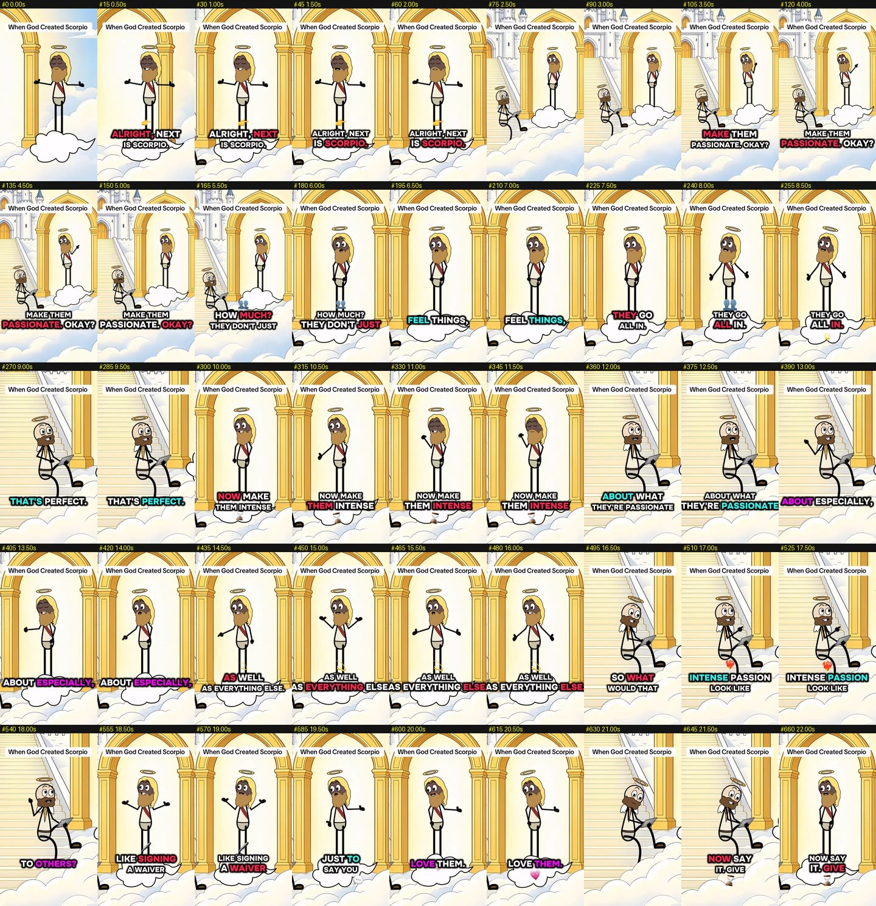
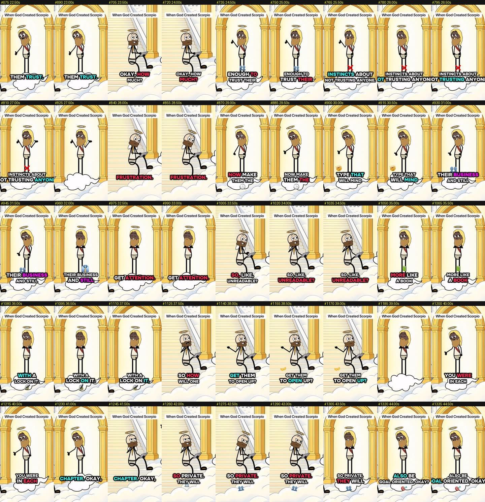
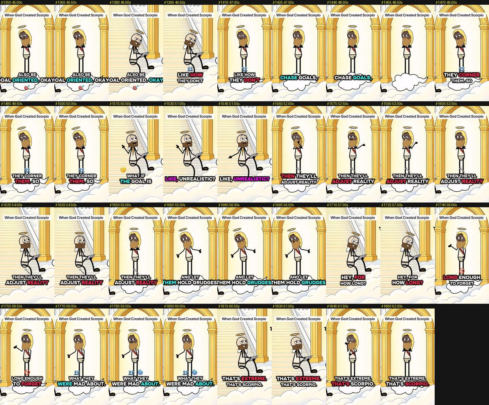

### 3.4 The other zodiac videos: trait → punch, as spoken

**B3 Cancer (304 k)**
- "Alright, next is Cancer. First, give them emotions." "Okay, how much?" "A lot." "Gotcha." "Now double it. Now multiply it by everybody in the room."
- "That won't be too much?" "They'll feel everyone's emotions, but confuse their own."
- "So what do they do?" "They'll hold it all in and tell everyone they're fine."
- "So what do they get out of this?" "Intuition."
- "Now make them nurturing… they'll always make sure everyone else is okay." "What about themselves?" "They'll get to that later."
- "Make them extremely sensitive." "Like how?" "The tone in a 'hey'." "That's nothing." "To you. To them? They think you hate them now." *(This is the post caption: "You said 'hey' differently and now Cancer thinks you hate them 😭".)*
- "Make them emotionally aware… of everyone." "Okay." "They'll analyse it." "It's kind of sweet." "They'll take it personal."
- **"That's exhausting." / "That's Cancer."**

**B4 Pisces (274 k), Heaven Immigration desk**
- "Last will be Pisces. Give this one clairvoyance." "For, like, seeing the future?" "No. The ability to feel it." "So would it be right?" "Often enough to make people nervous."
- "Now make them empathetic." "Okay, to what level?" "They'll absorb everyone else's emotions so much, they'll lose clarity of their own."
- "So they're hard to understand?" "Even to themselves, but can read everyone else like a book."
- "How do they function?" "They'll have the gift of escapism." "So, like, meditating?" "More like daydreaming and dissociating while someone is talking."
- "They'll also be creative." "So is that where they channel their emotions?" "Yes. And the fake arguments they've won in the shower."
- "They'll be the type that'll fall in love…" "Because someone made eye contact with them twice."
- "How sensitive?" "Someone gets distant for a week and they're writing poetry about betrayal."
- "…build strong connections that'll make people feel emotionally safe." "I love it." "Then confuse the chemistry with compatibility."
- "So what's their biggest weakness?" "Believing the person they imagined and the person they met are the same person."
- **"That's dreamy." / "That's Pisces."**

**B5 Sagittarius (247 k)**
- "Give them spontaneity." "Great, how much?" "They'll leave to run errands, then somehow come back with a passport stamp, a new hobby, a random life lesson, and a story nobody fully believes." *(a rule-of-four list)*
- "And routine will feel like a spiritual prison." "Is that serious?" "Keep them in the same place too long and even their soul starts pacing."
- "Make them very direct." "Okay, how much?" "They won't sugarcoat. They'll season with honesty." "Well, that's needed." "Until they realise some thoughts were supposed to stay indoors… and they already said it."
- "Make them love freely… because the moment love feels forced, they treat it like a hostage situation." "So what makes them stay?" "They need to feel like they're *choosing* to stay." *(This is the post caption: "Just don't make it feel like a life sentence".)*
- "They'll also be optimistic." "That's admirable." "It is, until they start calling a disaster 'character development'."
- "Make them the type to joke all day, then become a philosopher at 1 a.m." "That sounds exhausting." "For whoever answered the phone thinking it's an emergency."
- **"That's hilarious." / "That's Sagittarius."**

**B7 Gemini (128 k)**
- "This one shall have a quick mind." "Okay, how quick?" "They don't just hear what you said, they hear what you meant, and they'll have a response before you finish talking." "So they think fast?" "No. They think *ahead*."
- "Make them strongly opinionated." "…They'll argue your point, and still not agree with it." "That's confusing."
- "Give them the ability to read the room perfectly." "Nice." "They'll know exactly what not to say…" (beat) "…they'll say it."
- **The ending breaks the catchphrase** for a sign-specific twist (the twins): "…saying something *and* the opposite?" "It depends on which one's thinking." "Which one?" "Ah, yes. I put two in there."

### 3.5 Why the zodiac format performs
- **Identity, not information.** The viewer is the subject, and "that's literally me" is the strongest share trigger. Share rates are 2.7–4.1 %.
- **12 built-in sequels and a ready-made audience.** Each sign is a new video for the same format. "Next is…" tells people the series continues, so they follow to see their sign.
- **Roast-and-flatter balance.** Every flattering trait ("passionate", "nurturing", "creative") is undercut by a punch ("…long enough to forget what they were mad about"). People share flattering roasts; pure insults don't travel.
- **Spoken in the second person about "them".** Easy to send: "this is you".
- **The catchphrase ending** gives a satisfying, predictable button. You know it's coming, which makes the payoff feel earned.

---

## 4. The one-off sketches

### B2: "God inventing men" (412 k, highest share rate 3.57 %)

**Set:** a marble council chamber with a round table. God (grey suit, red tie) chairs a committee of angels: a blond man in a blue suit, a dark-skinned man with a white headband, and the bearded angel. **The format is a meeting vote.**

> GOD: "Alright, **day six**. We're inventing man today, and **I got tomorrow off**, so let's make this quick."
> *(the hook: biblical context, a deadline joke, and a promise of speed, all in 4 s)*
>
> "All in favour of giving man a super-high pain tolerance, say aye." "**Aye!**" "And what about a pain tolerance for **tummy aches**?" "**Nay.**"
> "All in favour of the ability to remember useless **sports knowledge**…" (aye) "…and the ability to remember any **weekend plans**?" "**Nay.**"
> "Giving them intense, deep emotions?" (aye) "And the ability to **express** those emotions?" "**Nay. Nay.**"
> "Physical traits. Giving him a big old beard and lots of hair." (aye) "And all of them **losing that hair before they're 30**?" "No, no…"
> "Alright, let's get creative. What if we made it more of a **lottery system**, where some guys lose their hair and some guys get to keep it?" "Yeah, I'm cool with that."
> "Housekeeping items. Do they like boobs?" "Aye!" "Butts?" "Aye!" "Feet?" (one angel, eagerly) "**Aye.**" "Oh, Lucifer, you little devil. You wanna just do a lottery system for this too? Some guys are feet guys, some guys aren't?" "Yes!"
> "One more item. Do guys like girly coffee drinks, reality TV shows… and cuddling?" "All in favour of men **secretly** liking this stuff." "Aye."
> ANGEL: "Wait. What's a girl?" GOD: "We're gonna circle back on that **after lunch**, actually." *(ends 1.9 s after the last word)*

Mechanics:
- **The aye/nay pattern** sets up a two-beat rhythm where the second item flips the first. This is rule-of-two comedy (yes to A, *no* to the obvious follow-up).
- **The "lottery system" callback** is reused twice.
- **The final line** sets up a sequel ("God inventing women") and makes woman's creation an afterthought, which gives people something to argue about in the comments.
- **Universal "men be like" observations** are tag-a-friend material, which matches the top share rate.

### B6: "When Jesus saw his self portrait" (145 k, 89 s)

**Set:** a marble colonnade with a bench. The characters are **name-tagged on screen** at the start ("GOD", "MICHAEL", later "JESUS").
- The story: God and Michael are told the humans "drew a picture" of Jesus.
- The cut at 52 s goes to a **real stained-glass / icon image of a European Jesus**, a mixed-media gag that breaks the cartoon style.
- Jesus (drawn dark-skinned, like God): "Who is this white man?" "It's you." God: "I'm sending another flood."
- The rest is Jesus talking God down ("no pillars of fire until Revelation… not many people make it to the end, to be honest").
- The title promises the reaction, and the reveal at 52 s pays it off. This is the densest dialogue of the eight (**3.3 words/s**, ~24 cuts a minute).

### B8: "God sending you another terrible person for character development 😂" (124 k, 28 s)

- God reads a book under the arch: "Okay, love of his life… give him another **toxic** one."
- Angels, alarmed: "God! …God!" God: "I know how old he is! **I made him!** This is for **character development**! I'm doing this because I **love** him. Send in the toxic…" and the very last word, the profanity, is the punch.
- This is the **shortest top video** and the only one ending on a shock word. The relatable dating pain plus the title spells out the joke, so it's understood instantly.

---

## 5. Hooks: the first 3 seconds

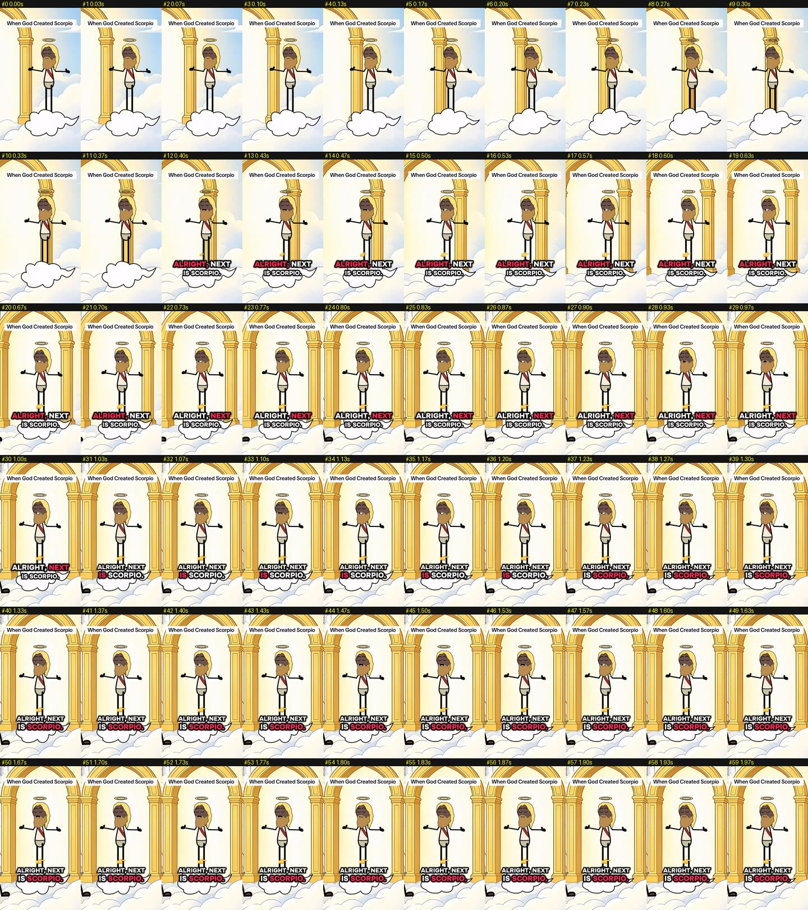

| | Frame 0 | Motion in first 0.7 s | First word | Opening line |
|---|---|---|---|---|
| B1 | Title box + God in arch | Background **slide transition** into the God shot (0–0.37 s); the shot reframes at 0.40 and 0.67 s | **0.37 s** | "Alright, next is Scorpio." |
| B2 | Title box + God CU at table | **Zoom-out whoosh** to the council-chamber wide (0.1–0.3 s), cut back to God at 1.0 s | **0.04 s** | "Alright, day six. We're inventing man today…" |
| B3 | Title box + God in arch | Same slide transition as B1 | 0.44 s | "Alright, next is Cancer." |
| B4 | Title box + God at heaven gates | Background **slides** from the pearly gates to the immigration desk (0–0.33 s) | 0.33 s | "Last will be Pisces." |
| B5 | Title box + God and angel wide | Settle into wide | 0.25 s | "Alright, next is Sagittarius." |
| B6 | Title box + **name tags** GOD / MICHAEL | Static, mid-conversation | 1.47 s | "I mean, his hair is kind of that colour, right?" (cold open, mid-scene) |
| B7 | Title box + angel at desk | Cut to God | 0.10 s | "Alright, next is Gemini." |
| B8 | Title box (3 lines + 😂) + God in arch | God already reading | 0.22 s | "Okay, love of his life…" |

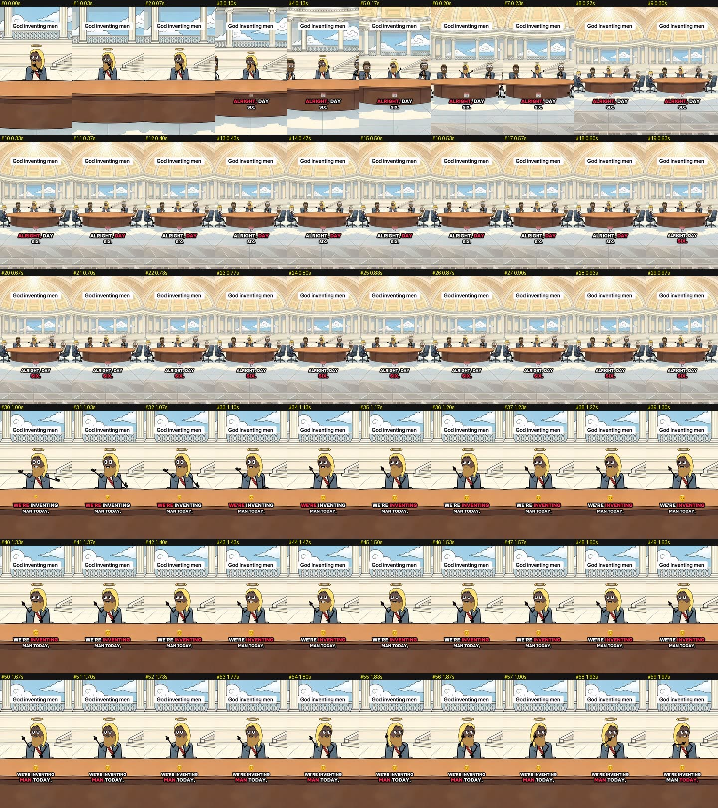
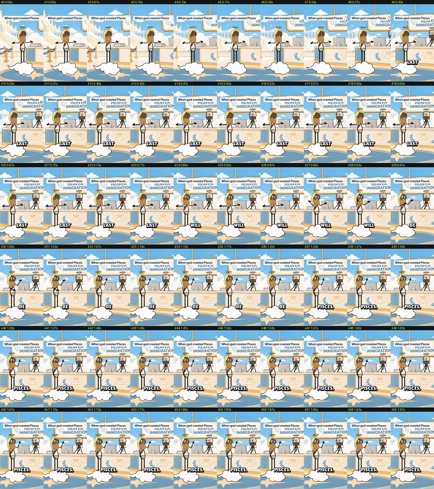

Hook rules distilled:
- **Title on frame 0 in TikTok's own text style** (white rounded box, black sans, about 10–15 % down from the top). It tells you the premise before the audio starts and looks native, not like an ad.
- **The picture moves before anything is said**: a background slide or zoom whoosh in the first 0.3–0.7 s. A static first frame would look like a still in the feed.
- **Speech starts within 0.5 s** in 7 of 8.
- **"Alright, next is…"** is an assembly-line opener. It implies you joined mid-series, which creates FOMO, and it names the identity (the sign) in the first second.

---

## 6. Why people rewatch and share

1. **Identity recognition, plus sending it to that person.** Share rates of 2.4–4.1 %; zodiac save rates up to 2.1 %.
2. **Joke density.** About one punch every 5 s for 60–90 s. Viewers who miss a line (captions move fast) replay.
3. **Loop seam.** Videos end **0.2–0.8 s after the last word** (B2 1.9 s, B7 1.0 s) on the catchphrase, then restart on the title and "Alright, next is…". The seams are clean because the opening and closing shots share the set and framing.

   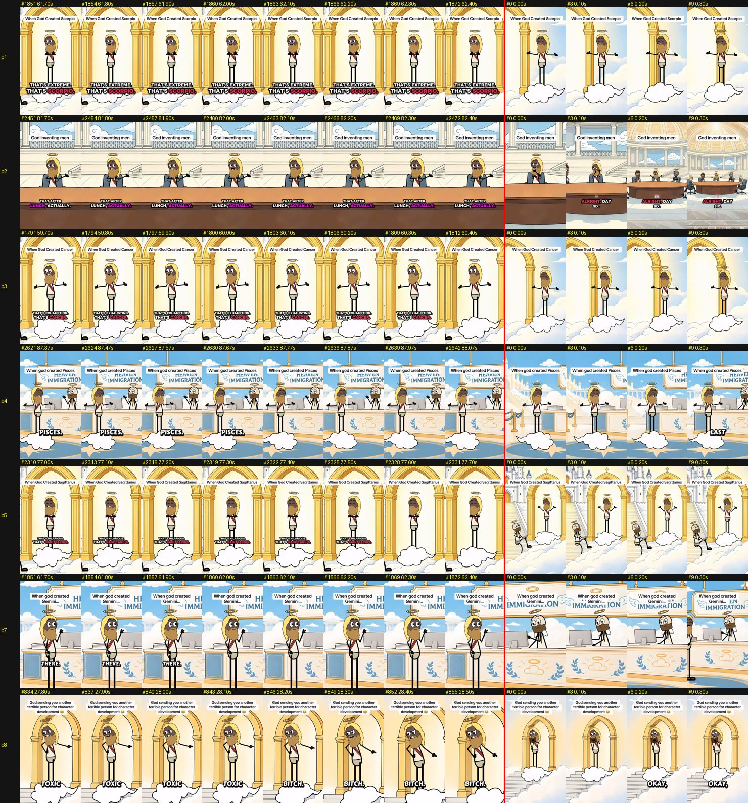

4. **Series memory.** The "That's [Sign]." button and the "next is…" opener make it a franchise people follow.
5. **Comment bait.** Signs disagreeing ("as a Scorpio this is wrong"), the "what's a girl?" ending, and God being drawn dark-skinned in the Jesus portrait video.
6. **Length past 60 s.** 7 of the top 8 run 60–89 s. Very likely deliberate: TikTok's Creator Rewards Program only pays on videos over one minute. Longer watch time also helps ranking.

---

## 7. Visual style

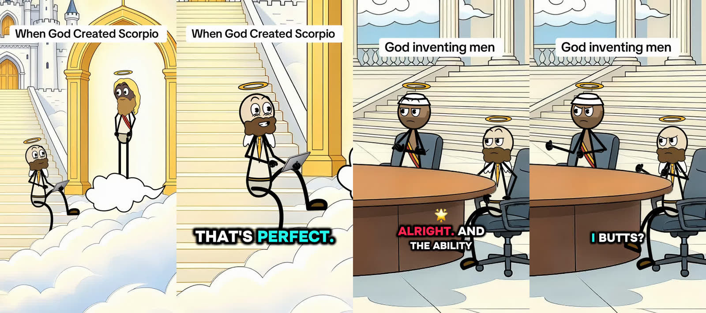
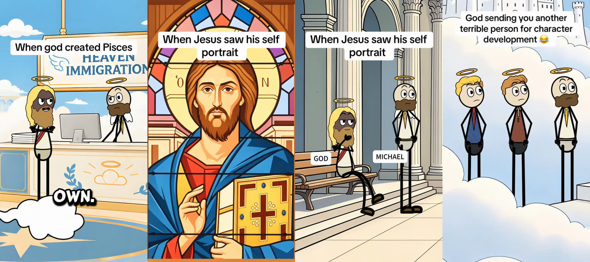

### 7.1 Characters
- **Simple puppet stickmen.** Large round heads with **visible eyelids** for expression (half-lidded smugness, wide eyes, side-eye) and thick black outlines.
- Bodies are a robe torso with **solid black stick limbs** and small black shoes. Faces are **cream-white**; God and some angels are brown-skinned.
- **Wardrobe reads the role:** a red sash marks God, small wings and a tablet mark the angel, suits and ties mark the council.
- **Halos everywhere.** A floating gold ellipse is the series' visual tag.

### 7.2 Backgrounds
- Painterly, softly shaded **illustrated sets** that look AI-generated: gold arches with cream light behind, a marble staircase, a fairy-tale castle, the "HEAVEN IMMIGRATION" desk with an iMac, a marble council chamber.
- Soft cloud floors frame the bottom third and leave room for captions.

### 7.3 Lighting and colour (measured on all frames, 30 fps)

| | Set | L\* mean | L\* SD | Near-white px (L\*>90) | Dark px (L\*<20) | Saturation | Warmth b\* |
|---|---|---|---|---|---|---|---|
| B1 Scorpio | Arch / stairs | 84.1 | 25.3 | **65 %** | 5.7 % | 0.23 | **+17.1** |
| B3 Cancer | Arch / stairs | **85.6** | 23.5 | **67 %** | 4.7 % | 0.22 | +16.5 |
| B5 Sagittarius | Arch / stairs | 85.3 | 23.3 | 65 % | 4.2 % | 0.24 | **+19.1** |
| B8 Character dev. | Arch | 83.8 | 24.3 | 65 % | 6.0 % | 0.22 | +13.2 |
| B4 Pisces | Immigration desk | 79.3 | 23.5 | 48 % | 5.2 % | 0.24 | +1.9 (sky blue) |
| B7 Gemini | Immigration desk | 78.9 | 22.9 | 46 % | 4.9 % | 0.25 | +2.0 |
| B2 God inventing men | Council chamber | 68.5 | **28.8** | 37 % | 5.5 % | 0.28 | +11.5 |
| B6 Jesus portrait | Colonnade | 67.6 | 27.2 | 30 % | 9.1 % | 0.19 | +4.7 |

What the numbers say:
- **Extremely high-key.** Half to two-thirds of every zodiac frame is near-white. "Heaven" literally glows, and it stands out against the darker average TikTok feed.
- **Warm gold vs. cool sky.** The arch sets are warm amber/cream; the immigration sets are neutral sky blue and white.
- **Almost no shadow.** 4–6 % of pixels are dark, and that is mostly outlines and limbs. Light is flat and diffuse, with a soft glow behind the arch.
- Contrast (L\* SD 23–29) comes from **black line art on white**, not from lighting.

### 7.4 Animation, camera and editing
- **Cut-out puppet animation, mostly on twos.** Native 30 fps (B2 and B6 at 24 fps), but **25–56 % of frames are held**, which works out to **13–22 new drawings per second**.
- **Motion vocabulary:** lip-sync, blinks and lid changes, a gesture per line (open-palm explain, point, shrug, hand-on-chin, arms crossed), the angel tapping the tablet, and a small emoji pop near each keyword.
- **Shot/reverse-shot on every speaker change.** God in the arch ↔ the angel on the stairs, with an occasional two-shot wide. **11–26 cuts a minute** (median shot 1.4–4.8 s). Calmer than the 6 uploaded skits (which cut up to every 1.4 s), because the dialogue carries it.
- **The camera is locked in almost every shot.** Exceptions:
  - the opening slide/zoom transition (§5)
  - a slow push-in to 1.16× under the emotional lines in B4 (70–81 s)
  - 1.06× punch-ins in B2 at 70.8 and 72.5 s (the "girly coffee drinks" list)
- **Mixed-media insert** (B6): a real stained-glass Jesus image for 1–2 s as the reveal.

---

## 8. Captions and on-screen text

Two caption styles appear, and the switch lines up with the account's breakout:

| Style | Videos | Spec |
|---|---|---|
| **A. Single-word pop** | B7 (13 Oct), B4 (14 Oct), B8 (16 Oct), B6 (19 Oct) | One word at a time, ALL CAPS, rounded cartoon display font (Luckiest Guy / Lilita-like), white with a thick black outline and drop shadow. Lower-middle, at ~72–80 % of height. |
| **B. Two-line karaoke, rotating colour** | **B1 (20 Oct), B2 (23 Oct), B3 (23 Oct), B5 (26 Oct)** | 2–5 words over 1–2 lines, ALL CAPS heavy geometric sans (Montserrat Black-like), white with black stroke and shadow. **The active word is recoloured, rotating between red #FD2551, cyan #23F5ED and magenta #FE01FC.** A small **emoji icon** pops beside the key word (📅 for "tomorrow", ⚡ "super high", 😣 "tummy aches", 🎯 "goal-oriented", ❌ "not trusting", 💗 "love them", 👥 "everyone"). Placed at ~72–80 % of height, over the cloud. |

- **Every video posted on or after 20 Oct in the top 8 uses Style B.** These include the account's four biggest (446 k, 412 k, 304 k, 247 k).
- Style A videos peaked at 274 k, and most were lower.
- That's a correlation, not proof: the account was also growing. But the karaoke style holds the eye longer and is the better default.

**Title box:** TikTok's native text tool. A white rounded rectangle with black text, "When God Created Scorpio", on screen for the whole video, about 10–15 % down from the top.

---

## 9. Sound

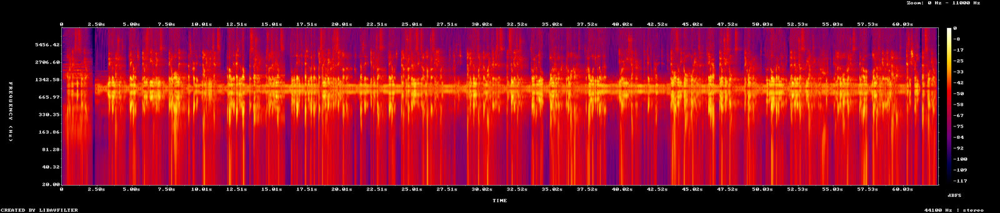

| | Integrated | LRA | True peak | Music bed | Bed vs. voice | Silence |
|---|---|---|---|---|---|---|
| B1 Scorpio | −23.0 LUFS | 3.6 LU | −6.5 dBFS | yes | ~15 dB under | 0.6 % |
| B2 Men | −20.5 | 11.4 | −6.0 | yes | ~23 dB under | 0.2 % |
| B3 Cancer | −21.6 | 6.2 | −5.7 | yes | ~22 dB under | 0.6 % |
| B4 Pisces | −17.4 | 2.0 | −5.8 | yes, louder | ~11 dB under | 0.6 % |
| B5 Sagittarius | −23.4 | 4.3 | −6.9 | yes | ~19 dB under | 0.5 % |
| B6 Jesus | −22.7 | 10.6 | −7.3 | **no** | – | **16 %** |
| B7 Gemini | −16.5 | 2.5 | −4.8 | yes, louder | ~12 dB under | 0.1 % |
| B8 Char. dev. | −16.8 | 5.5 | −5.8 | **no** | – | 9 % |

- **Dialogue-only voice track, labelled "original sound – Berry".** It is a two-hander (God and the angel) with distinct voices, recorded or generated dry, with lines butted tight.
- **One shared, soft music bed under the whole zodiac series.** B1, B3, B4, B5 and B7 have the same low-frequency spectral fingerprint in their quietest moments (peaks at 64, 102–129 and 156–161 Hz). That points to a quiet ambient pad that becomes part of the series' sonic identity. It sits 11–23 dB under the voice, so the gaps never go dead.
- **No SFX, no laugh track, no reaction clips.** The writing carries the comedy. The one-off sketches (B6, B8) drop the bed and use real pauses for timing.
- **Not loudness-maximised:** −16.5 to −23.4 LUFS with true peaks around −5 to −7 dBFS. TikTok normalises playback anyway.
- **Speech density:** 2.1–2.9 words/s averaged over the whole video for zodiac (the lines themselves run faster, with short beats between Q and A). B6 runs 3.3 words/s.

---

## 10. Distribution and packaging

| Element | What Berry does |
|---|---|
| **Post caption** | The single most relatable punch line from the script, plus an emoji: "Scorpio trusts their gut. Their gut trusts nobody 🤣", "You said 'hey' differently and now Cancer thinks you hate them 😭". The sign emoji (♋️♐️) leads on later posts. |
| **Hashtags** | `#tiktokscaryhorrorcontest` on nearly every post (contest-tag riding), plus `#[sign] #zodiac #horoscope #astrology #comedy` for zodiac, or `#drama #funny #animation #fyp #usa #GOD` for sketches. |
| **Cadence** | 1–2 posts a day, 08:30–10:00 UTC (US night owls and Europe/Africa morning). |
| **Series tagging** | "When God Created …" is the same title template every time. "HEAVEN'S IT GUY" is episodic. |
| **Format** | 1080×1920, 24/30 fps, H.264, 60–90 s. |

---

## 11. Berry vs. the six uploaded skits

| | **@berry889888** (top 8) | **Uploaded stickman skits** (6) |
|---|---|---|
| Length | **60–90 s** (one 28 s) | 10–31 s (one 81 s) |
| Premise | Identity / relatable observation (zodiac, "men be like") | Situational reversal (courtroom, jail, classroom) |
| Joke structure | **Many small punches** (~every 5 s), catchphrase ending | **One big punch** at the end, reaction hold |
| Laugh cue | None; the writing carries it | Real-person laughing meme clip, horn/ding SFX |
| Cast | God + note-taking angel (fixed series cast) | Judge/cop/dad + twist character |
| Look | **High-key heaven** (L\* 79–86), warm gold, almost no shadow | Mid-key sets (L\* 52–72), varied temperature |
| Edit | Shot/reverse-shot, 11–26 cuts/min, almost no camera moves | Static stage *or* fast shot/reverse-shot with crash zooms and zoom-punches |
| Animation | Puppet on twos (13–22 drawings/s) | Fuller, 23–30 drawings/s |
| Captions | Two-line ALL-CAPS karaoke, rotating red/cyan/magenta + emoji | Serif karaoke with a pink active-word box, or one-word caps |
| Audio | Continuous dialogue over a soft music bed | Dry dialogue, true silences, SFX on beats |
| Why it spreads | "This is you" sharing, series following | Rewatch for the twist, laugh-along |

**Shared DNA:**
- speech within 0.5 s
- a straight man feeding a funny character
- the punch word last
- karaoke captions
- shot/reverse-shot on speaker change
- flat, shadowless lighting
- AI-assisted backgrounds
- hard-cut endings that loop

---

## 12. Blueprint: an original identity-series in this style

Use the *mechanics*, not Berry's characters, art, titles or jokes. "When God created ___" is a long-running public meme format, but Berry's specific God/angel designs, sets and scripts are theirs.

1. **Pick an identity axis with 8–16 members** people proudly claim: zodiac signs, MBTI types, birth order, job roles, countries, gamer classes, love languages.
2. **Build a factory premise with two roles:** a *maker* who dictates and a *clerk* who asks "how much?". Give each a fixed design and one fixed set, plus one alternate set.
3. **Script template** (60–75 s, 10–12 traits):

   ```
   MAKER: "Alright, next is <X>."
   MAKER: "Make them <flattering trait>."   CLERK: "Okay, how much?"
   MAKER: "<behaviour that exaggerates it until it's a flaw>."
   … ×10 (alternate flattering → roast) …
   CLERK: "That's <one adjective>."   MAKER: "That's <X>."
   ```

4. **Frame 0:** the title in TikTok's native text box, a 0.3–0.5 s background slide or zoom, and the first word by 0.4 s.
5. **Look:** high-key (L\* ~80+), a warm key colour for the main set, black line art, no shadows, captions on a clean lower-middle band.
6. **Captions:** 2-line ALL-CAPS karaoke with 3 rotating highlight colours (#FD2551 / #23F5ED / #FE01FC) and a small emoji per key noun.
7. **Audio:** tight dialogue plus one signature soft music bed about 15–20 dB under the voice, reused for the whole series.
8. **Packaging:** caption the post with the best punch line plus an emoji, use the identity hashtag, and post daily at a consistent time. Run the series until every member is covered, then start "Part 2".

---

## 13. Limitations

- **Comments were not available**, so "why people share" is inferred from share/save ratios and the content, not read from viewers.
- **Counts are a snapshot** (6 Nov 2026, ~15:08 UTC). Newer videos (Nov 3–6) haven't finished accumulating views.
- **Transcripts are machine-made** (Whisper small.en) and cross-checked against burned-in captions.
  - Speaker attribution is inferred from who is on screen.
  - A few words are uncertain (B7's middle section, some of B6's overlapping lines).
  - Whisper looped on one B6 window; it was re-transcribed in shorter windows.
- **I can't hear audio.** Voice and music descriptions come from spectra, levels and transcripts.
- **"Over 60 s for the Creator Rewards Program" is an inference** from the lengths, not something the creator stated.

---

### Files
- `data/all_43_videos_stats.csv`: every video's views, likes, comments, shares, saves, length, date and series.
- `data/top8_metadata.json`: captions, hashtags and stats for the analysed 8.
- `data/b*_transcript_chunks.json`: timed transcripts.
- `data/b*_frame_metrics_30fps.csv`: per-frame light, colour and motion.
- `data/top8_visual_summary.json`: shots, cuts and cadence.
- `frames/`: 30 fps hook sheets (B1, B2, B4), the full Scorpio video at 2 fps (3 sheets), 1 fps sheets (B4, B6, B8), loop seams, style stills and spectrograms.
- The videos themselves are **not** committed (they're the creator's content).
