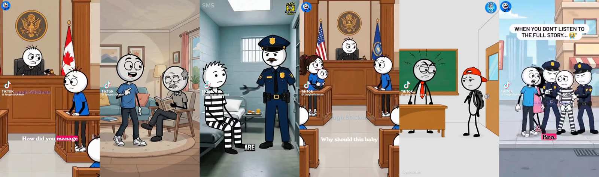
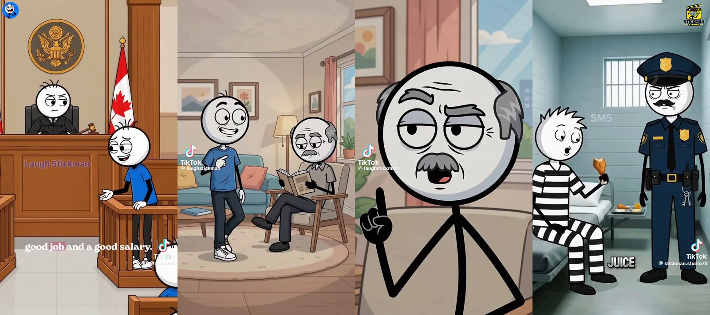
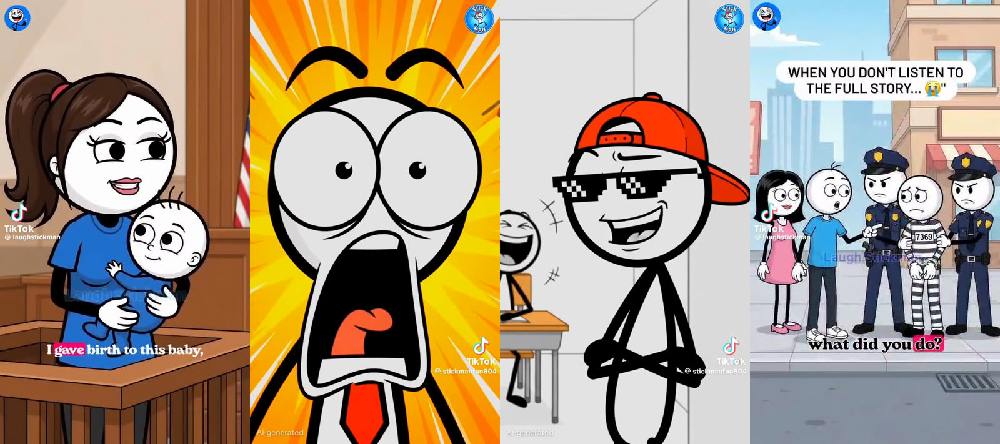
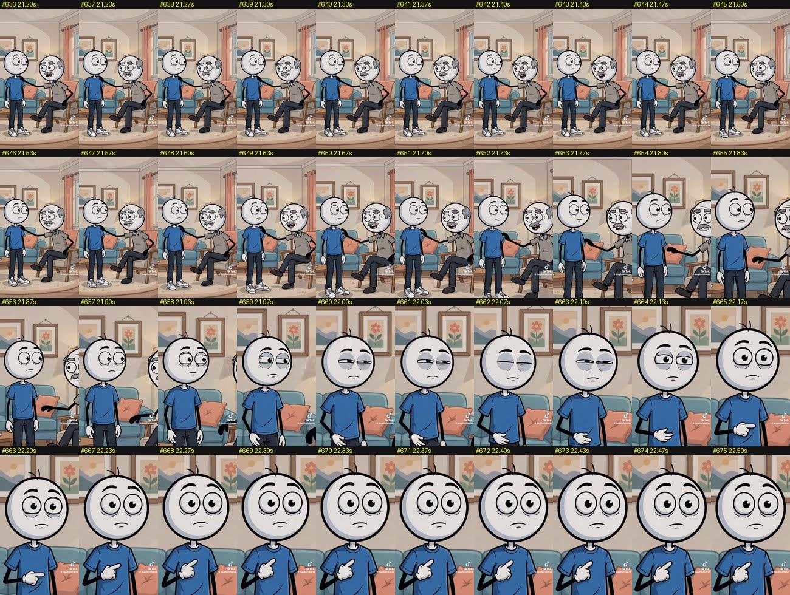
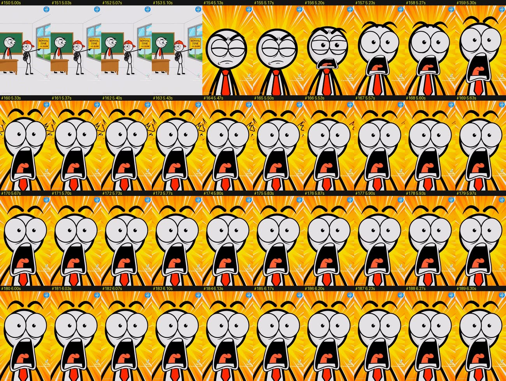
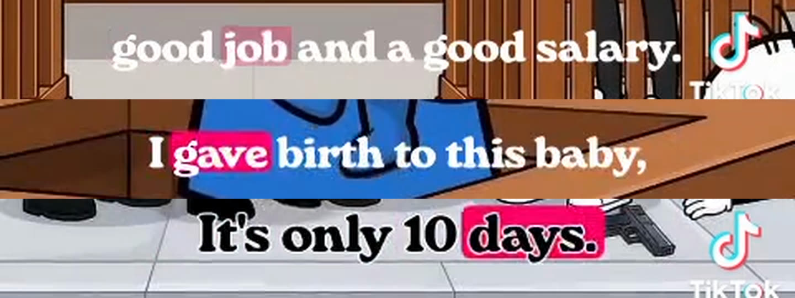
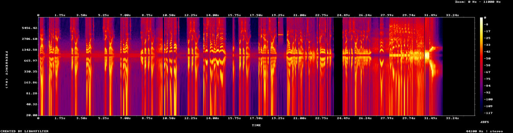

# Viral Stickman Skits: Frame-by-Frame Breakdown

A study of the six stickman comedy videos supplied for the `@berry889888` request. It covers script, hook, edit, camera, animation, lighting, colour, captions and sound, and what makes people rewatch.

> **Scope note.** This report covers the **six attached MP4s**. The six files carry watermarks from three stickman channels (`@laughstickman`, `@stickman.studio78`, `@stickmanfun804`), not `@berry889888`.
>
> **The `@berry889888` profile itself** (43 videos, top 8 analysed frame by frame) is covered in **[berry889888/berry889888-analysis.md](berry889888/berry889888-analysis.md)**. Its style is quite different: 60–90 s "When God Created [Zodiac Sign]" dialogues. That report ends with a side-by-side comparison of the two styles.

---

## 0. Method

| What | How |
|---|---|
| Frame analysis | Every video resampled to **30 fps**, **5,842 frames** measured. Per frame: CIE L\* brightness (mean, SD, 5th/95th percentile), saturation, colourfulness, warmth (b\*), tint (a\*), edge density, frame difference, histogram distance, and ORB/RANSAC camera transform (zoom/pan/rotation). |
| Native cadence | Each file also read at its **native** rate (V1, V4 and V6 are 24 fps; V2, V3 and V5 are 30 fps containers) to find held frames, the drawing rate and freezes. |
| Visual review | About **1,300 frames** viewed directly in contact sheets: a 5 fps overview of every video, plus **full 30 fps** sheets of every hook, every punchline, every reaction hold and the special moves (crash zoom, zoom-punch, gunshot). |
| Speech | Whisper small.en (ONNX), per line and full-pass, cross-checked against the burned-in captions. Pitch per line from an autocorrelation tracker. |
| Sound | Spectrograms, EBU R128 loudness, gap noise floor, spectral analysis of every non-speech event (SFX). |
| Data | `research/data/`: per-frame CSVs, audio JSON, shot summaries. Code is in `research/tools/`. |

File mapping used throughout:

| ID | Uploaded file | Watermark | Premise |
|---|---|---|---|
| **V1** | `399e7191…mp4` | @laughstickman | Courtroom: judge vs. burglar |
| **V2** | `83f02362…mp4` | @laughstickman | Son tells dad he wants to get married |
| **V3** | `69b157d6…mp4` | @stickman.studio78 | Freed prisoner refuses to leave jail |
| **V4** | `bc61d9a4…mp4` | @laughstickman | Custody battle, the "ATM" argument |
| **V5** | `3d111c94…mp4` | @stickmanfun804 | Late student: "School zone – go slow" |
| **V6** | `73201d83…mp4` | @laughstickman | "How long is your sentence?" |



---

## 1. TL;DR: the formula

1. **Two characters, one recognisable set, one question.** A straight-man authority (judge, dad, cop, teacher, or a prisoner who has seen it all) asks a question in a setting you identify in one frame: courtroom, living room, jail, classroom, street.
2. **No intro.** Someone is already talking or moving on frame 0. The first word lands at **0.12–0.6 s** (1.0 s in V6, which uses an on-screen title card instead).
3. **Premise understood in 1–4 s.** The question itself *is* the premise ("Why should this baby stay with you?").
4. **The twist character answers with a reversal, a pun, or a twisted analogy.** The punch word sits at the very end of the last line ("…or the ATM?", "…death penalty in 10 days.").
5. **A held reaction shot (0.3–1.5 s)** gives the audience a laugh cue: jaw drop, blank stare, eye-pop. It is often emphasised with a zoom-punch, shake, horn, ding or thud.
6. **A laugh payoff.** A hard cut (V3: a 10-frame dissolve) to a **real-life crying-laughing reaction clip** with 😂/🤣 stickers, mixed **~10 dB louder** than the dialogue. V5 uses an in-world class laugh instead.
7. **Short.** 10–31 s of content for five of the six; V3 is the long-form outlier at 81 s.
8. **Dialogue-only sound.** No music bed. Lines are separated by true digital silence, with one or two SFX on the beat.
9. **Captions carry the eyes.** Karaoke captions (3–5 words, active word on a hot-pink box) or single-word ALL CAPS. Viewers read along, so silent-autoplay viewers stay.
10. **Visual consistency.** The same white-headed stickman cast (the **blue-shirt everyman** recurs in V1, V2, V4 and V6). Thick black outlines, soft flat lighting, painterly backgrounds. The art has the look of AI-generated illustration, and TikTok shows an "AI-generated" label on V5.

---

## 2. The six videos at a glance

Content length excludes the 4.0 s TikTok download outro on every file.

| | Content | Lines / words | Speech rate | Cuts (avg shot) | Camera | Captions | Laugh payoff |
|---|---|---|---|---|---|---|---|
| **V1** | 10.7 s | 2 / 36 | **4.5 words/s** | 1 (locked wide 9.4 s) | Locked wide | Karaoke serif | Meme clip 1.3 s |
| **V2** | 31.0 s | 13 / 58 | 3.2 (median line) | 16 (1.8 s) | Close-ups, slow push-in, crash zoom, zoom-punch | **None** | 2 meme clips, 2.8 s |
| **V3** | 81.1 s | 39 / 185 | 3.3 | 0 hard cuts (76 s single take) + dissolve | Locked wide | One word, ALL CAPS | Meme clip 4.5 s |
| **V4** | 18.3 s | 6 / 55 | 3.9 | 6 (2.6 s) | Locked, wide/CU alternation | Karaoke serif | Meme clip 1.1 s |
| **V5** | 10.0 s | 5 / 23 | 3.9 | 6 (1.4 s) | Push-in, shake, zoom-punch | **None** | In-world class laugh |
| **V6** | 19.7 s | 10 / 45 | 3.9 | 1 (locked wide 18.5 s) | Locked wide | Title card + karaoke serif | Meme clip 1.2 s |

Conversational English runs about 2.5–3 words/s. These run **3.2–4.6 words/s (190–275 wpm)**: fast, tight, no dead air except where it is deliberate.

Median gap between speakers: **V4 0.35 s, V3 0.39 s, V6 0.61 s, V1 0.69 s, V2 0.70 s.**

---

## 3. Full transcripts, beat sheets and shot lists

Timestamps are seconds from the start of the file. Caption chunks in `[brackets]` are exactly as burned in on screen.

### V1: The burglar and the judge (10.7 s)

**Shot 1 (0.00–9.43), locked wide.** The judge sits centre-back at the bench (Canadian flag, gold seal). The defendant in the blue shirt stands foreground-right in the witness box. A third character's head is cropped bottom-right as foreground framing. Measured camera drift: under 1.5 %, effectively static.

| Time | Speaker | Line | Visual |
|---|---|---|---|
| 0.00 | (judge) | already mid-gesture on frame 0 | angry brows, gavel hand |
| 0.50–3.93 | **JUDGE** | "How did you manage to steal from a house while the owner was still inside?" | `[How did you manage] [to steal from a] [house while the] [owner was still inside?]` Captions start at 0.33 s. |
| 3.93–4.62 | (0.69 s pause) | | Defendant's face shifts from nervous to smug: half-lidded eyes, he leans on the rail. |
| 4.62–9.18 | **DEFENDANT** | "Sir, you already have a good job and a good salary. Why would you need to learn how to do this?" | `[Sir,] [you already have a] [good job and a good salary.] [Why would you need] [to learn how to do this?]` Palms-up shrug, smug grin. |
| ~9.0–9.43 | | (reaction) | The judge's face goes blank and stunned. |

**Shot 2 (9.43–10.70).** Real-life laughing-man clip, letterboxed on black, 😂 stickers top-left and bottom-right. Peaks are **+9 dB** over the dialogue.

**Joke mechanic: reversal.** The defendant reframes the judge's question as the judge asking for a tutorial, so the authority figure is implicated.

### V2: "Say sorry" / marriage training (31.0 s)

| # | Shot | Time | Speaker / line | Notes |
|---|---|---|---|---|
| 1 | Wide two-shot, living room | 0.00–2.00 | **SON:** "Dad." (0.12) "I wanna get married." (0.72) | Son walks in on a walk cycle, grinning and pointing at himself. Dad is in an armchair reading. |
| 2 | CU dad | 2.00–3.47 | **DAD:** "Say sorry." (2.53) | Deadpan heavy lids, index finger raised. |
| 3 | CU son | 3.47–4.93 | **SON:** "For what?" (3.81) | Points to self, confused. |
| 4 | CU dad | 4.93–6.47 | **DAD:** "Say sorry." (5.17) | Same deadpan. |
| 5 | CU son | 6.47–7.90 | **SON:** "But for what?" (6.57) | Palms-up shrug, worried brows. |
| 6 | Wide two-shot | 7.90–10.00 | **DAD:** "You first say sorry." (8.18) | Son standing, wilting. |
| 7 | CU son | 10.00–11.63 | **SON:** "But what's my fault?" | Both index fingers point at himself. |
| 8 | CU dad (new angle, arms crossed) | 11.63–13.17 | **DAD:** "First, say sorry." (11.96) | |
| 9 | MCU son | 13.17–15.60 | **SON:** "At least tell me the reason!" (13.22) | Hands up, teary puppy eyes. **Slow push-in 1.000→1.028.** The son's pitch peaks here (~310 Hz). |
| 10 | Tight CU dad | 15.60–17.13 | **DAD:** "First, say sorry." (16.08) | |
| 11 | CU son | 17.13–19.67 | **SON:** "Okay, Dad, I'm sorry." (17.64) | Defeated lids. A yellow ⚡ "hit" mark pops by his head (18.4–19.2). **"Ding" SFX at 19.4 s (2.6 kHz).** |
| 12 | Wide, then crash zoom | 19.67–24.13 | **DAD:** "Now you are ready for marriage, my son. Your training is complete." (19.88) | Dad's hand on son's shoulder at 20.0 s. **Crash zoom 21.6→22.0 s (1.0×→2.4×, ease-in) onto the son's face.** He sighs (lids drop), then his eyes widen and he points at himself. |
| – | | 23.63–24.38 | **0.75 s of dead digital silence (−100 dBFS); the picture also holds (longest freeze in the video, 0.53 s)** | The comedic pause before the punch. |
| 13 | Medium two-shot | 24.13–27.10 | **DAD:** "You've learned to say sorry without any reason." (24.38) | Dad gives a smug thumbs-up. |
| 14 | CU dad | 27.10–27.30 | | 0.2 s insert of a smug grin. |
| 15 | CU son | 27.30–28.17 | (shocked vocal, ~420 Hz) | Realisation take: lids heavy, then eyes snap wide and the jaw drops. **Zoom-punch +1.6 %.** |
| 16 | Meme A | 28.17–29.00 | real laughter | Man laughing, 🤣 sticker top-left. |
| 17 | Meme B | 29.00–30.97 | real laughter | A different man laughing into a microphone, collapsing on the desk. |

**Joke mechanic: repetition ×5, then a reveal that re-frames every earlier beat.** Marriage means apologising without a reason. The **voice pitch tracks the escalation**: the son goes **168 → 222 → 244 → 281 → 311 Hz**, then collapses to **170 Hz** on "Okay, Dad, I'm sorry", while the dad stays flat at **125–157 Hz** the whole time.

### V3: The prisoner who won't leave (81.1 s)

**One locked wide for 76 s.** A cold blue cell. The prisoner (spiky hair, black-and-white stripes) sits left on a bunk; the cop (navy uniform, moustache) stands right; a food tray with chicken sits on the table. Captions show one word at a time.

- **0.00–0.13 s: four frames of the *ending*** (prisoner lying back asleep, cop standing, caption "DREAMS"). This sets the thumbnail and makes a seamless loop seam. The real opening follows: the cop enters through the swinging barred door.

| Time | Speaker | Line |
|---|---|---|
| 0.60 | COP | "You are free to go. We found out you are innocent." |
| 3.45 | PRISONER | "No, sir. I want to stay here." |
| ~5.5 | COP | "Stay in the cell?" |
| 7.01 | PRISONER | "Yes, best decision of my life." *(leans back, hands behind head)* |
| 9.19 | COP | "Why do you want to stay in a cell?" |
| 12.77 | PRISONER | "My rent expired. My landlord chased me out." |
| ~15.0 | COP | "So you chose prison?" |
| 16.78 | PRISONER | "Free bed? Free food? Free security?" *(counts on raised hand: a rule-of-three list)* |
| 20.57 | COP | "Free food? The food in here is terrible." *(⚡ mark by his head)* |
| 23.32 | PRISONER | "Terrible? The food here is sweet." |
| 26.23 | COP | "Sweet?" |
| ~27–28 | | *(prisoner picks up a chicken leg and bites: prop gag)* |
| 28.52 | PRISONER | "Chicken on Friday. Juice every day. I eat like a king." *(rule of three again)* |
| 32.18 | COP | "This is prison, not a hotel." |
| 34.15 | PRISONER | "Five-star. Best hotel in town." |
| 36.68 | COP | "There's no room service here." |
| 38.52 | PRISONER | "Then why do you bring my food to my room?" |
| 41.82 | COP | "That's it. I'm dragging you out." |
| 44.31 | PRISONER | "Drag me? You will have to catch me first." |
| 47.64 | COP | "Catch you? You are in a cell!" *(both hands up)* |
| 49.88 | PRISONER | "Exactly. Safest place on Earth." |
| 51.99 | COP | "Your landlord is outside. He said sorry. He wants you back." *(hands on head, 52–54 s)* |
| 56.32 | PRISONER | "Tell him I'm busy." |
| 57.77 | COP | "Busy?" |
| 58.68 | PRISONER | "Busy. Dinner is at 7. I can't miss the chicken." |
| 63.76 | PRISONER | "Sir, please lock the cell door." |
| 65.94 | COP | "Lock it? You're supposed to leave!" |
| 67.91 | PRISONER | "And don't forget my night food." *(stands, walks over, points)* |
| 70.82 | COP | "Night food?" |
| 72.36 | PRISONER | "Sweet dreams need sweet food." *(lies back, eyes closed: the frame used as the cold open)* |
| 74.4–76.3 | | *(cop walks out; barred door slides shut; prisoner asleep, smiling)* |
| 76.27–76.60 | | **~10-frame cross-dissolve** to the full-frame laughing-man clip (no letterbox, no emoji), 4.5 s |

**Joke mechanic: absurd inversion sustained by an *echo-question engine*.** The cop repeats the prisoner's last word as a question ("Stay in the cell?", "Sweet?", "Catch you?", "Busy?", "Lock it?", "Night food?", **8+ times**), which hands the prisoner the next joke. Jokes land roughly every **5–8 s**. The median gap between speakers is **0.39 s**.

### V4: The custody battle / ATM (18.3 s)

| # | Shot | Time | Speaker / line | Notes |
|---|---|---|---|---|
| 1 | Locked wide courtroom (US flags) | 0.00–1.67 | **JUDGE:** "Why should this baby stay with you?" | `[Why should this baby] [stay with you?]` Caption on frame 0. Mother with baby left, father right, judge centre-back, back of a lawyer's head bottom-centre. |
| 2 | CU mother + baby | 1.67–5.67 | **MOTHER:** "Your Honor, I gave birth to this baby, so the baby belongs with me." | `[Your Honor,] [I gave birth to this baby,] [so the baby belongs] [with me.]` Confident, side-eye. |
| 3 | CU judge | 5.67–7.80 | **JUDGE:** "What do you have to say?" | Eyes slide to the father. |
| 4 | Wide | 7.80–8.67 | **FATHER:** "Your Honor," | Raises index finger. |
| 5 | MCU father | 8.67–15.70 | **FATHER:** "let me ask you something. If I put my card into an ATM and take out money, does that money belong to me or the ATM?" | Calm, knowing smirk, open-palm "explaining" gesture loop. |
| 6 | Locked wide | 15.70–17.17 | (reaction, 1.47 s) | All heads turn; the judge's jaw drops (16.4–17.0); the mother is stunned. A tonal sting/gasp at ~16.2 s. |
| 7 | Meme | 17.17–18.30 | real laughter | Same laughing-man clip as V1, 😂 letterbox. |

**Joke mechanic: an analogy punchline with innuendo.** It is never stated outright, so the viewer has to "do the maths". That drives rewatches and "explain this" comments.

### V5: The late student (10.0 s)

| # | Shot | Time | Speaker / line | Notes |
|---|---|---|---|---|
| 1 | Wide classroom, flat white | 0.00–2.63 | **TEACHER:** "Why are you late?" (0.12) / **STUDENT:** "Because of the sign outside, sir." (1.13) | Teacher (red tie) has anger veins and vibration lines and points at the door. Student wears a backwards red cap and backpack and shrugs. **Slow push-in 1.000→1.047.** |
| 2 | CU teacher | 2.63–3.47 | **TEACHER:** "What sign?" | **"?" thought bubble**, camera shake. |
| 3 | Wide | 3.47–5.13 | **STUDENT:** "School zone, go slow." | A yellow **SCHOOL ZONE – GO SLOW** sign now shows in the window; the student points to it. |
| 4 | **Smash cut:** extreme CU teacher | 5.13–6.37 | **AIR HORN** (−14.6 dBFS, the loudest moment) | **Yellow-orange sunburst background** (b\* +37.6, saturation 0.67). The eyes pop past the head outline and the jaw drops to the chest. **Zoom-punch +14.7 % for 1–2 frames**, then shake marks. |
| 5 | Wide | 6.37–7.37 | class laughter SFX | The whole class laughs; the student leans on the wall, arms crossed. |
| 6 | CU student | 7.37–9.07 | **STUDENT:** "I was just following the rules, sir." | A pixel **"deal-with-it" sunglasses** meme drops onto his face. Smug grin. |
| 7 | Wide | 9.07–10.00 | laughter | Tag shot. |

**Joke mechanic: literal-interpretation pun, plus a tag line after the punch.** The class laugh is the in-world laugh track, so there is no external meme clip.

### V6: "Sentence" (19.7 s)

**One locked wide street** (sidewalk, city skyline, brick building with striped awning).

| Time | Speaker / line | Visual |
|---|---|---|
| 0.00–4.10 | **On-screen title:** "WHEN YOU DON'T LISTEN TO THE FULL STORY... 😭" | White pill box, black ALL-CAPS sans, top of frame. |
| 0.00–0.9 | | Two cops walk prisoner #7369 (handcuffed) one way; the husband (blue shirt) and wife (pink dress) walk the other. The groups cross, then the husband turns back. |
| 1.04 | **HUSBAND:** "Bro, what did you do?" | `[Bro,] [what did you do?]` |
| 3.13 | **PRISONER:** "I killed my wife." | Deep, flat voice (~125 Hz). |
| 4.43 | **HUSBAND:** "Huh?" | Tiny reaction vocal. |
| 5.25 | **HUSBAND:** "How long is your sentence?" | Leans in, interested. |
| 7.64 | **PRISONER:** "Just 10 days." | |
| 8.6–9.9 | | The husband grabs the cop's pistol and points it at the wife's head. **Two muzzle flashes (9.27, 9.50) plus a bass thud** (58 % of energy below 150 Hz). She falls flat. |
| 10.0 | **HUSBAND:** "Hahaha. Take me with you too. It's only 10 days." | Laughing, hands up. |
| ~14.0 | | One cop fades out (an opacity dissolve; a staging shortcut). |
| 14.12 | **PRISONER:** "You should have listened to my whole sentence first." | |
| 16.20 | **PRISONER:** "I'm getting the death penalty in 10 days." | |
| 18.0–18.53 | (shocked vocal/sting) | The husband's eyes go wide and his jaw drops. |
| 18.53–19.70 | real laughter | Same laughing-man meme. |

**Joke mechanic: a double-meaning pun** ("sentence" as grammar vs. as a prison term), plus misdirection and a dark-humour overreaction. The title card tells you a twist is coming, so the payoff feels earned and you rewatch to catch the setup.

---

## 4. Script anatomy: how the writing works

### 4.1 Hook patterns (first 3 seconds)

| | Frame 0 | First word | First caption | Premise clear by | Hook type |
|---|---|---|---|---|---|
| V1 | judge mid-speech | 0.50 s | 0.33 s | 3.9 s | Accusation question in a high-stakes setting |
| V2 | son walking in | 0.12 s | – | 1.75 s | Relatable life announcement ("I wanna get married") |
| V3 | **ending frame (thumbnail)** | 0.60 s | 0.63 s | 6.5 s | Inversion ("You're free" / "No, I want to stay") |
| V4 | courtroom wide + caption | 0.12 s | 0.00 s | 1.7 s | Stakes question (custody) |
| V5 | angry teacher pointing | 0.12 s | – | 0.9 s | Universal confrontation ("Why are you late?") |
| V6 | **title card + walking crowd** | 1.04 s | 0.00 s (title) | 4.2 s ("I killed my wife") | Framing title plus a shock line |

Rules distilled:
- **Open on a question** (5 of 6). A question is an open loop the brain wants closed.
- **The setting is the genre label.** Courtroom = "clever answer incoming"; jail = "absurd prisoner"; dad + son = "life lesson / roast".
- **Something moves on frame 0** (walking, gesturing, a door swinging). There is never a still title card on its own.
- **No branding intro, no "wait for it", no music sting.**

### 4.2 Line construction
- **2–8 words per line** is typical; the longest is 21 (V1). Vocabulary is simple and global. The only slang is "Bro".
- **The punch word comes last:** "…or the **ATM**?", "…without any **reason**.", "…death penalty in **10 days**.", "…learn how to **do this**?", "…following the **rules**, sir."
- **Rule of three / lists:** "Free bed? Free food? Free security?" and "Chicken on Friday. Juice every day. I eat like a king."
- **Repetition with escalation:** "Say sorry" ×5 (V2).
- **Echo questions** keep long dialogues moving (V3, 8+ times).
- **Title/address words** add formality that the joke later punctures: "Sir," "Your Honor," "my son".
- **Tags after the punch:** V5 "I was just following the rules, sir." V3 "Sweet dreams need sweet food."

### 4.3 Joke structures used

| Structure | Where |
|---|---|
| Reversal: authority gets owned | V1 (judge), V4 (mother/judge), V5 (teacher), V3 (cop) |
| Reveal re-frames everything before it | V2 (the marriage "training"), V6 (the full sentence) |
| Pun / double meaning | V5 ("go slow"), V6 ("sentence") |
| Analogy with innuendo | V4 (card / ATM) |
| Absurd premise, sustained | V3 (prison is a hotel) |
| Dark-humour overreaction | V6 (shoots his wife for a 10-day sentence) |

Most of these are **classic internet / WhatsApp jokes** re-staged as animation. The value added is performance, timing and packaging, not originality of the joke.

### 4.4 The end sequence (identical grammar in all six)

```
last line (punch word last)
   → reaction hold 0.3–1.5 s   (blank / jaw-drop / eye-pop, often zoom-punch + SFX)
   → laugh payoff 1–4.5 s      (real crying-laughing clip + 😂/🤣 stickers, ~+10 dB)   or in-world laugh (V5)
   → end (TikTok outro in these downloads)
```

| | Punch ends | Reaction | Laugh payoff starts | Gap |
|---|---|---|---|---|
| V1 | 9.18 | judge blank stare | 9.43 | 0.25 s |
| V2 | ~26.9 | smug-dad insert + son eye-pop | 28.17 | ~1.3 s |
| V3 | 74.86 | cop leaves, prisoner sleeps | 76.27 (dissolve) | ~1.4 s |
| V4 | 15.91 | wide: judge's jaw drop | 17.17 | 1.26 s |
| V5 | ~5.1 | **instant** horn + eye-pop | 6.37 (class laughs) | 0 s |
| V6 | ~17.9 | husband jaw drop | 18.53 | ~0.6 s |

---

## 5. Why people watch again (retention mechanics)

1. **Short runtime with a late punch.** The payoff sits in the last 10–15 % of the runtime, so the "what did I just hear?" moment hits right before the loop restarts.
2. **Implicit jokes reward a second pass.** The ATM analogy (V4) and the "sentence" pun (V6) only fully click once you replay the setup. That means more rewatches, more "explain" comments, more watch time.
3. **Loop seam.** V3's first four frames *are* its last scene, so a replay looks continuous. The others end on a laugh and restart on a question, which is also seamless.
4. **Laugh-track social proof.** The real-person laughing clip tells you *this is the funny part* and lets you laugh along. It is the TikTok version of a sitcom laugh track.
5. **Captions hold silent viewers.** Word-by-word highlighting forces reading pace, and the eyes stay locked on the lower third.
6. **No dead time.** 3.2–4.6 words/s, speaker gaps of about 0.4 s, and cuts placed *before* the next speaker starts (§7.2). The only silence is the deliberate pre-punch pause (V2: 0.75 s).
7. **Underdog wins / authority gets owned.** Satisfying and shareable ("send this to your dad / teacher / lawyer friend").
8. **Edgy beats invite comments** (V6's gun, V4's innuendo), and comments push distribution.
9. **Recognisable cast and look.** Viewers who liked one Laugh Stickman clip recognise the blue-shirt guy instantly, which brings familiarity and a follow.

---

## 6. Visual style




### 6.1 Characters
- **Head:** a big circle, warm off-white fill **#DEDCD8** (not pure white), with a **cool grey shade crescent #AFB2B9** on the lower-right edge. That implies a soft key light from the upper left.
- **Outline:** thick black (about 5–7 px at 1024 px height), uniform weight, rounded joins.
- **Eyes:** large white circles with small black pupils. Heavy lids and grey eye-bags carry most of the acting (smug, tired, deadpan). The brows are the second acting tool.
- **Mouth:** opens to a dark red interior with a pink/red tongue. About 4–6 mouth shapes are used for lip-sync.
- **Body:** stick limbs (solid black lines) emerging from real clothes: t-shirt, jeans, white sneakers. Laugh Stickman uses **white four-finger cartoon gloves**; Stickman Studio uses black hands.
- **Hair as identity:** 3–5 antenna strands (everyman), spiky (prisoner), bald with grey sides and a moustache (dad, cop), brown ponytail with lashes and lipstick (mother).
- **Wardrobe colour coding:** the hero's **cobalt-blue shirt #0E69D3–#216ECA** recurs across V1, V2, V4 and V6. Authority is **navy #10293F–#283350** (police), black robes (judge), or a **red tie** (teacher). Prisoners wear black-and-white stripes with a number (#7369).

### 6.2 Backgrounds
- **@laughstickman (V1, V2, V4, V6):** detailed, painterly 2D illustrations that read as AI-generated: courtroom wood and seals, a cosy living room with framed art, lamp, plant and rug, a city street. Edges are soft and textures subtle. The characters sit *on* the background with almost no cast shadow.
- **@stickman.studio78 (V3):** a **near-photoreal / 3D-render jail cell** with flat cartoon characters on top. The contrast between real space and flat toon is part of the look.
- **@stickmanfun804 (V5):** minimal flat vector: white walls, one-point perspective lines, with colour only in accents (green board, red cap and tie, yellow sign).

### 6.3 Lighting, contrast and colour (measured, content frames only)

| | L\* mean | L\* SD (contrast) | L\* p5 / p95 | Dark px (L\*<20) | Saturation | Colourfulness | Warmth b\* | Read |
|---|---|---|---|---|---|---|---|---|
| V1 courtroom | 54.3 | 23.5 | 18.5 / 93.3 | 8.8 % | 0.46 | 67 | **+18.5** | Warm amber wood, mid-key |
| V2 living room | 57.4 | 24.2 | 3.4 / 87.3 | 11.5 % | 0.28 | 41 | +2.9 | Muted pastel, soft radial "spotlight" glow on the wall behind characters |
| V3 jail | 52.2 | **27.4** | 5.2 / 96.0 | **22.6 %** | 0.22 | 25 | −2.8 (a\* −3.4, cyan) | Cold fluorescent, highest contrast, desaturated |
| V4 courtroom | 52.3 | 27.0 | 6.6 / 97.2 | 12.7 % | **0.48** | **71** | +12.5 | Warm, saturated |
| V5 classroom | **72.4** | 26.5 | 19.3 / 90.0 | 8.8 % | 0.26 | 66 | +8.9 | High-key white; the **shock shot jumps to b\* +37.6, saturation 0.67** |
| V6 street | 67.0 | 24.7 | 15.2 / 96.2 | 8.2 % | 0.23 | 48 | −4.7 | High-key, sky blue |
| Meme clips | ~36 | ~32 | – | – | ~0.51 | – | +10 | Darker real footage, a visual "break" |

Takeaways:
- **Flat, shadowless, evenly lit** characters. The dark pixels are mostly outlines and stick limbs, not shadows. Readability beats mood.
- **The background sets temperature.** Warm for home and court, cold for jail and street.
- **The colour/saturation spike marks the joke peak** (V5 sunburst). The darker, real-footage meme clip is a deliberate tonal break that says "this is the laugh".
- Mid-to-high key throughout (L\* 52–72), with near-white highlights (p95 at 87–97), so it reads well on a phone at any brightness.

---

## 7. Movement, camera and editing

### 7.1 Animation cadence
- The animation is authored at **24 fps "on ones"**. The 30 fps files show the 24→30 pulldown signature: **4 changed frames, then 1 duplicate**, repeating.
- **Something is always moving.** 72–92 % of native frames differ from the previous one: talking head-bobs, mouth flaps every 2–3 frames, blinks, eye darts, gesture loops (open-palm explain, finger raise, self-point, shrug, arms crossed).
- **Freezes are rare and deliberate.** They only happen on reaction holds (V4 0.25 s at 16.9 s, V6 0.29 s at 18.2 s) and on V2's pre-punch silence (0.53 s at 23.4 s).
- **Acting takes:**
  - **Nervous → smug** (V1 defendant)
  - **Deadpan** (V2 dad)
  - **Escalating distress** (V2 son)
  - **Realisation take**: heavy lids, then the eyes snap open and the jaw drops (V2 end)
  - **Eye-pop scream** (V5)
  - **Jaw-drop reaction** (V4, V6)
- **Symbols and VFX vocabulary:**
  - anger veins and vibration lines (V5)
  - "?" thought bubble (V5)
  - yellow ⚡ impact mark by the head (V2, V3)
  - zig-zag shake marks (V5)
  - sunburst background (V5)
  - muzzle flash (V6)
  - pixel "deal-with-it" glasses (V5)
  - laugh scribbles around the classmates (V5)
- **Staging shortcuts:** characters re-blocked between beats in the same wide, and a cop simply fades out (V6). Nobody notices at phone size.

### 7.2 Editing

| | Style | Cuts | Avg shot | Notes |
|---|---|---|---|---|
| V1, V3, V6 | **Single locked wide ("stage")** | 0–1 | 9–76 s | The characters and captions do all the work. |
| V2, V4, V5 | **Shot/reverse-shot on every speaker change** | 6–16 | 1.4–2.6 s | Wide, CU, CU, wide… with the punch reaction back in the wide (V4) or a CU (V2). |

- **Cuts lead the dialogue.** In V2 every cut lands **0.05–0.53 s before** the next speaker's first word (median about 0.3 s). You see the speaker *before* they talk.
- The **reaction cut** comes on or just before the last word of the punch (V4 cuts to the wide at 15.70 s on "ATM?", 0.2 s before the line ends).
- **Transitions:** hard cuts everywhere. The one exception is V3's ~10-frame cross-dissolve into the meme.

### 7.3 Camera moves (measured as similarity transform vs. the first frame of each shot)

| Move | Where | Measured |
|---|---|---|
| Locked off | V1, V3, V4 (all shots), V6 | under 1–2 % drift |
| **Slow push-in** (tension) | V5 0–2.6 s; V2 13.2–15.6 s | +4.7 % over 2.6 s; +2.8 % over 2.4 s |
| **Crash zoom** (realisation) | V2 21.6–22.0 s | 1.0× → 2.4× in 0.4 s, ease-in, continuing to 2.9× by 23.9 s |
| **Zoom-punch** (impact) | V5 5.13 s; V2 27.4 s | +14.7 % for 1–2 frames then settle; +1.6 % |
| **Camera shake** | V5 2.6–3.5 s, 5.1–5.6 s | ±2–3 % scale jitter, up to 30 px |

Rule: **the camera only moves to underline an emotional beat.** Otherwise it is a static stage.




---

## 8. Captions and on-screen text



| Style | Used in | Spec (measured) |
|---|---|---|
| **Karaoke serif** | V1, V4, V6 | Heavy rounded serif (Cooper/Recoleta-like), sentence case. Centred at **~77–80 % of frame height** (lower third, above the TikTok UI). **3–5 words per chunk**. The active word sits on a **rounded hot-pink box #E10E6C–#E91162**. Text is **white over darker backgrounds, black over light ones** (V6 sidewalk). It advances word by word in sync with the voice (~4–5 words/s). |
| **One-word punch caption** | V3 | ALL CAPS, condensed heavy sans (Bebas/Anton-like), white-to-silver gradient with a dark outline/bevel. **One word on screen at a time**, about 82 % down, slightly left of centre. Numerals as digits ("7"). |
| **Title card** | V6 | White rounded pill at the top (about 7–12 % down), black ALL-CAPS clean sans, ends with "... 😭". On screen for **0–4.1 s only**. |
| No captions | V2, V5 | Performance and close-ups carry it. These are also the two with the most cuts. |

Branding overlays seen:
- Channel avatar badge top-left (Laugh Stickman) or top-right (Stickman Studio and the third channel).
- A semi-transparent channel-name watermark mid-frame ("Laugh Stickman", "SMS").
- The standard moving TikTok watermark.
- On V5, TikTok's **"AI-generated"** label.

---

## 9. Sound



| | Integrated loudness | Loudness range | Level between lines (vs. speech peaks) | Music bed? |
|---|---|---|---|---|
| V1 | −19.2 LUFS | 8.9 LU | −43 to −47 dB (faint tonal room tone, about −50 dBFS) | no |
| V2 | −20.7 LUFS | 10.4 LU | −36 to −49 dB; **pre-punch pause −100 dBFS (digital silence)** | no |
| V3 | −19.6 LUFS | **4.0 LU** | mostly −75 to −80 dB (true silence) | no |
| V4 | −19.8 LUFS | 7.6 LU | −69 to −74 dB | no |
| V5 | **−15.9 LUFS** | 3.2 LU | −69 to −71 dB | no |
| V6 | −18.5 LUFS | 8.4 LU | −40 to −51 dB | no |

(Integrated figures include the TikTok outro jingle. True peak is 0.0 dBFS in all six files, reached in the laugh clips and jingle.)

- **Voices:** clean, studio-dry, perfectly intelligible, each line separated by digital silence. That is consistent with **AI text-to-speech or separately recorded lines** placed on a timeline. Each character has a distinct register:

  | | Character | Median pitch (approx.) |
  |---|---|---|
  | V2 | Dad | 125–157 Hz, flat |
  | V2 | Son | 168–311 Hz, rising with frustration |
  | V6 | Prisoner | 125–143 Hz, flat |
  | V6 | Husband | 200–280 Hz |
  | V4 | Mother | ~232 Hz |
  | V4 | Judge | ~162–182 Hz |
  | V4 | Father | 124–158 Hz, calm |
  | V5 | Teacher | ~250 Hz, shouting |
  | V5 | Student | ~225 Hz |
  | V1 | Judge / defendant | ~169 / ~176 Hz (the contrast is in delivery, not register) |
  | V3 | Cop | ~148–165 Hz on statements, 225–260 Hz on incredulous echo questions |

- **SFX on the beat only:**
  - V2 **"ding"** at 19.4 s (2.6 kHz): the apology is "accepted"
  - V5 **air horn** at 5.1 s (−14.6 dBFS, the loudest moment)
  - V5 **kids' laughter** at 6.4 and 9.1 s
  - V6 **gunshot/thud** at 9.0–10.0 s
  - V6 shocked vocal/sting at 17.9 s
  - V4 tonal sting/gasp at 16.2 s
  - V2 shocked "whaa" vocal at 27.3 s
- **Dead-air comedy pause:** V2 drops to −100 dBFS for 0.75 s right before the punch line.
- **Laugh payoff mixed hot:** about **+9 to +13 dB** above dialogue peaks. The audio energy jumps exactly when the picture switches to real footage.

---

## 10. Packaging details

- **Vertical 9:16.** These are 576×1024 / 480×854 because they are TikTok downloads; produce at 1080×1920.
- **The 4.0 s TikTok outro** (logo plus `@handle` search bar) on every file is the **download watermark**, not part of the creative.
- **Thumbnail/first-frame trick (V3):** put the funniest *end* frame on frames 0–3.
- **Length tiers:** micro (10 s: V1, V5), short (18–31 s: V2, V4, V6), long-form dialogue (81 s: V3, kept alive by an echo-question engine and a joke every 5–8 s).

---

## 11. Production blueprint: making original skits in this style

Use the *structure*. Write your own jokes and characters, and use your own or licensed reaction footage (see §12).

### 11.1 Beat sheet (15–25 s skit)

| Time | Beat | Notes |
|---|---|---|
| 0.0 s | Frame 0 is moving; optional title card or end-frame cold open | No logo intro |
| 0.1–2.0 s | **STRAIGHT MAN asks the premise question** | ≤ 10 words, in a one-glance setting |
| 2–5 s | **TWIST character's first answer** | Deflection, naive, or literal |
| 5–15 s | 1–4 escalating exchanges | Echo questions, rule-of-three lists, repetition |
| T | **Punch line, punch word LAST** | Optional 0.5–0.75 s dead-silent pause before it |
| T+0.2–1.5 s | **Reaction hold** | Jaw drop / eye-pop / blank. Zoom-punch +3–15 %, horn/ding/thud |
| +1–3 s | **Laugh payoff** | In-world crowd laugh, or a licensed laughing clip, ~+10 dB |
| End | Hard cut | First frame should loop cleanly from here |

### 11.2 Spec sheet
- **Animation:** 24 fps on ones. Constant idle motion (bob, blink). Lip-sync with 4–6 mouth shapes. Gesture loops while talking.
- **Camera:** locked wide by default. Cut to a CU per speaker for 3+ exchanges and lead each cut by ~0.3 s. Slow push-in (+3–5 % over 2–3 s) for tension. Crash zoom or zoom-punch only on the realisation or punch.
- **Look:**
  - Off-white heads #DEDCD8 with a grey shade #AFB2B9 lower-right, thick black outlines, stick limbs plus clothing, white gloves.
  - A recurring hero in a cobalt-blue shirt.
  - Backgrounds detailed but soft, mid-to-high key (L\* 52–72).
  - Warm sets for home and court, cool sets for jail and street.
  - A saturated burst only at the peak.
- **Captions:** heavy serif, 3–5 words per chunk, lower third at ~78 %, active word on #E10E6C, white or black by background. Alternative: one-word ALL CAPS.
- **Audio:**
  - Dialogue at about −16 to −20 LUFS integrated, no music bed, silence between lines.
  - Distinct pitch per character (low deadpan vs. high excitable).
  - 3.2–4.5 words/s, speaker gaps of ~0.3–0.7 s.
  - 1–3 SFX on beats; laugh payoff about +10 dB.

### 11.3 Script template

```
TITLE (optional, 0–4 s): WHEN YOU <relatable mistake>... 😭

[SET: <one-glance location>]  WIDE, locked

STRAIGHT: <premise question, ≤10 words>?
TWIST:    <deflection that hints at the twist>.
STRAIGHT: <echo question>?
TWIST:    <item 1>? <item 2>? <item 3>?
STRAIGHT: <frustrated echo>!
TWIST:    <PUNCH — setup words ... PUNCH WORD>.
          [0.3–1.5 s REACTION: STRAIGHT jaw drop | SFX: horn/ding/thud | zoom-punch]
[LAUGH PAYOFF 1–3 s]
```

---

## 12. Cautions

- **Reaction clips of real people** (all of V1, V2, V3, V4 and V6 use them; the source watermarks are visible) are other people's footage and likeness. Reusing them invites copyright and likeness claims. Animate your own laughing-crowd stickman or license a clip.
- **Don't re-upload** other creators' skits (the watermarks show these six belong to three different channels), and don't copy their characters, channel art or specific scripts. The formula is free to use; the assets aren't.
- **Dark-humour beats** (V6's gun) boost comments but can trigger TikTok's violence filters and limit distribution. Use them knowingly.
- If you use AI imagery or voices, TikTok expects the **AI-generated** disclosure (as on V5).

---

## 13. Limitations

- This report covers the six attached files. The `@berry889888` account's own top videos are analysed separately in `berry889888/berry889888-analysis.md`.
- The transcripts are machine (Whisper small.en) cross-checked against the burned-in captions where present. V2 and V5 have no captions, so their text is ASR only (it read cleanly).
- Pitch values come from an autocorrelation tracker and may be off by an octave on shouted or laughing lines. Treat them as relative.
- I can't listen to audio. Voice character and SFX identities are inferred from spectra, loudness and ASR tags (e.g. "*HORN*", "[LAUGHTER]").

---

### Appendix: frame sheets in `research/frames/`
- `v1_hook30.jpg`, `v3_hook30.jpg`, `v5_hook30.jpg`, `v6_hook30.jpg`: the first 1.3–2 s, every frame at 30 fps
- `v2_zoom30.jpg`, `v5_shock30.jpg`, `v6_gun30.jpg`: special moves at 30 fps
- `v2_end30.jpg`, `v4_end30.jpg`, `v3_end30.jpg`: punch → reaction → laugh-clip handoff at 30 fps
- `v*_overview_*fps_part1.jpg`: first ~8–12 s of each video
- `v*_spectrogram.jpg`: full-length audio spectrograms
